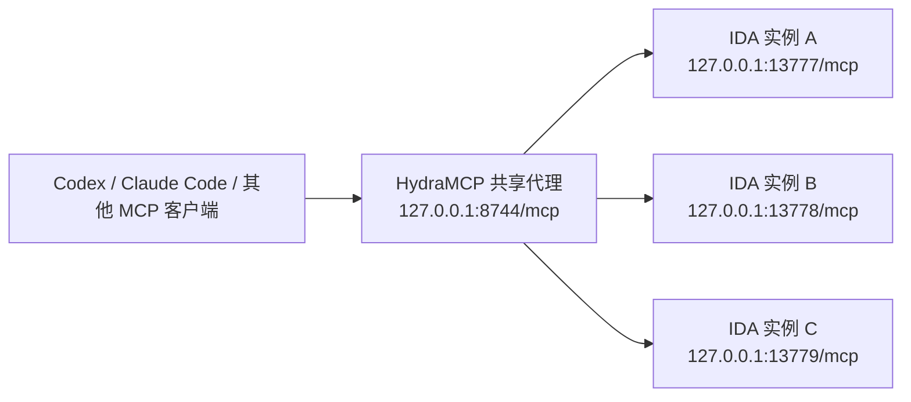

<p align="center">
  
</p>

<h1 align="center">HydraIDAMCP</h1>

<p align="center">
  面向多题并行场景的 <code>ida-pro-mcp</code> 多会话增强版
</p>

<p align="center">
  <a href="./README_EN.md">English</a>
</p>

<p align="center">
  
  
  
  
</p>

HydraIDAMCP（简称 **HydraMCP**）是基于 [`ida-pro-mcp`](https://github.com/mrexodia/ida-pro-mcp) 的增强版本，主要解决 **CTF / RE / PWN / Malware** 等场景下“**同时打开多个 IDA，但模型总是容易连错实例**”的问题。

它不是重写一个新的 MCP，而是在原有插件和服务架构基础上增加了：

- **共享代理入口**：统一连接 `http://127.0.0.1:8744/mcp`
- **多 IDA 实例并行**：每个 IDA 使用独立本地端口
- **按会话绑定实例**：不同 MCP 会话可绑定到不同 IDA
- **实例选择工具**：支持按 `binary` 或 `idb` 精确切换
- **自动生成提示词**：启动后直接生成可发给模型的 prompt
- **支持自定义 prompt 模板**：保留你的个人分析习惯

> 如果你经常同时开多个题、多个 IDA、多个对话窗口，HydraMCP 的目标就是：**始终让模型分析到正确的那个实例。**

---

## 特性

- 固定共享代理入口：`8744`
- 自动发现并管理多个本地 IDA MCP 实例
- 每个 IDA 自动分配独立端口，如 `13777`、`13778`、`13779`
- 支持按 MCP transport session 绑定实例
- IDA 内一键启动：`Ctrl + Alt + M`
- 自动生成带绑定步骤的 prompt
- 支持 `select_instance_by_binary(...)`
- 支持 `select_instance_by_idb(...)`
- 支持 `current_instance()`
- 支持 `list_instances()`
- 支持自定义 prompt 模板
- 与上游 `ida-pro-mcp` 的包名与 CLI 保持兼容

---

## 为什么需要 HydraIDAMCP

原版 `ida-pro-mcp` 更偏向单实例工作流：

- 1 个 IDA
- 1 个 MCP 服务
- 1 条分析链路

但在真实的 CTF 二进制题场景里，往往是：

- 同时打开 2~5 个 IDA
- 每个题一个 IDB
- 模型需要明确知道“当前到底分析哪一个”
- 不希望每开一个 IDA 就去修改一次 MCP 配置

HydraIDAMCP 解决的核心问题就是：

> **多个 IDA 实例共用一个 MCP 入口，同时允许每个会话稳定地绑定到正确的目标。**

---

## 架构

HydraMCP 采用两层结构：

1. **共享代理（Shared Proxy）**
   - 固定入口：`127.0.0.1:8744`
   - MCP 客户端只需要连接这一个地址

2. **本地实例（Local IDA Instance）**
   - 每个 IDA 启动一个自己的本地 MCP 服务
   - 默认从 `13777` 开始自动分配空闲端口



共享代理内部维护：

> **MCP transport session -> IDA instance**

因此不同会话可以分别绑定到不同题目，而不是全部抢同一个 IDA。

---

## 快速开始

### 1）安装项目

如果你是从源码使用，推荐这样安装：

```bash
git clone https://github.com/<你的用户名>/HydraIDAMCP.git
cd HydraIDAMCP
pip uninstall ida-pro-mcp -y
pip install -e .
```

如果你后续发布到了 GitHub，也可以直接安装：

```bash
pip uninstall ida-pro-mcp -y
pip install git+https://github.com/<你的用户名>/HydraIDAMCP.git
```

### 2）安装插件到 IDA

```bash
ida-pro-mcp --install
```

> 命令名依然是 `ida-pro-mcp`，这是兼容设计，不是写错了。

### 3）配置 MCP 客户端

把 MCP 客户端统一指向共享代理：

```toml
[mcp_servers.ida_pro_mcp]
enabled = true
url = "http://127.0.0.1:8744/mcp"
```

### 4）在每个 IDA 中启动

打开题目后，在每个 IDA 窗口中按：

```text
Ctrl + Alt + M
```

插件会自动：

1. 检查共享代理 `8744` 是否已运行
2. 如未运行，自动拉起共享代理
3. 为当前 IDA 分配本地端口
4. 注册当前实例
5. 生成一段可直接发给模型的 prompt

### 5）把生成的 prompt 发给模型

自动生成的 prompt 默认已经包含：

- 当前 `IDB`
- 当前 `Binary`
- 绑定步骤
- `select_instance_by_idb(...)`
- `select_instance_by_binary(...)`
- `current_instance()`

所以多数情况下，你只需要：

> **打开 IDA -> 按 `Ctrl + Alt + M` -> 把生成的 prompt 发给模型**

---

## 安装说明

### 环境要求

- Python **3.11+**
- IDA Pro **8.3+** / **9.x**
- 可用的 IDAPython 环境
- **不支持 IDA Free**

### 方式一：从源码安装

```bash
git clone https://github.com/<你的用户名>/HydraIDAMCP.git
cd HydraIDAMCP
pip uninstall ida-pro-mcp -y
pip install -e .
ida-pro-mcp --install
```

### 方式二：从 GitHub 直接安装

```bash
pip uninstall ida-pro-mcp -y
pip install git+https://github.com/<你的用户名>/HydraIDAMCP.git
ida-pro-mcp --install
```

### 安装后注意事项

- 安装插件后请**完整重启 IDA**
- 某些 MCP 客户端可能会常驻后台，也建议彻底退出再重新打开
- 如果你之前装过原版 `ida-pro-mcp`，建议先卸载再装当前版本

---

## 使用方式

HydraMCP 的日常使用可以非常简单。

### 1. 打开目标

每个题目开一个 IDA。

### 2. 在每个 IDA 中按一次快捷键

```text
Ctrl + Alt + M
```

这一键会自动完成：

- 启动或复用共享代理
- 启动当前 IDA 对应的本地 MCP 实例
- 注册当前实例
- 生成可直接使用的 prompt

### 3. 直接把自动生成的 prompt 发给模型

这是 HydraMCP 的一个实用小优点：

- **自动生成 prompt**
- **prompt 自带绑定参数**
- **prompt 自带绑定步骤**
- **不需要你每次手写 `select_instance...`**

也就是说，模型一开始就知道：

- 当前该分析哪个题
- 应该先调用哪些 IDA MCP 工具
- 不应该切换到别的 IDA 实例

### 4. 只有在需要时才手动切换

如果你确实想手动绑定或切换实例，也可以直接使用：

```text
list_instances()
current_instance()
select_instance("127.0.0.1", 13778)
select_instance_by_binary("checkin.exe")
select_instance_by_idb("D:/ctf/re/checkin/checkin.i64")
```

一句话工作流：

> **打开 IDA -> 按 `Ctrl + Alt + M` -> 发送自动生成的 prompt**

---

## Prompt 模板

HydraMCP 支持本地 prompt 模板，用来生成“只分析当前实例”的提示词。

这部分的设计目标很明确：

- 默认模板足够短，开箱即用
- 自动带上当前实例的绑定参数
- 不干扰你原本的分析思路
- 允许你改成自己喜欢的风格

### 默认路径

Windows：

```text
%APPDATA%\Hex-Rays\IDA Pro\mcp\prompt_template.txt
```

也可以通过环境变量指定：

```text
IDA_MCP_PROMPT_TEMPLATE
```

### 默认模板示例

```text
你现在是 CTF 二进制分析与解题助手。

请调用 IDA MCP 分析当前题目。

请只分析这个题目，不要切换到其他 IDA 实例。

IDB: {idb_path}
Binary: {binary}

先绑定并确认当前实例：
{binding_steps}

题目类型:
题目描述:
目标:
```

### 支持的占位符

- `{idb_path}`
- `{binary}`
- `{binding_steps}`
- `{local_instance_url}`
- `{shared_proxy_url}`
- `{select_instance_by_idb}`
- `{select_instance_by_binary}`
- `{current_instance_call}`
- `{list_instances_call}`

### 自定义模板

你可以直接修改模板文件，让它更符合自己的工作流，例如：

- 更偏 RE
- 更偏 PWN
- 更偏 Malware
- 更偏个人习惯

HydraMCP 不限制模板风格，只负责把当前实例信息和绑定参数正确注入进去。

---

## 常用工具

```text
list_instances()
current_instance()
select_instance("127.0.0.1", 13778)
select_instance_by_binary("checkin.exe")
select_instance_by_idb("D:/ctf/re/checkin/checkin.i64")
```

---

## 兼容性说明

为了尽量减少迁移成本，HydraIDAMCP 保留了上游的包名和 CLI 名称：

- Python 包名：`ida_pro_mcp`
- CLI 命令名：`ida-pro-mcp`

因此：

- **项目名 / GitHub 仓库名**：`HydraIDAMCP`
- **简称**：`HydraMCP`
- **运行时包名**：仍然兼容 `ida-pro-mcp`

这使它更像一个**增强版构建**，而不是一套全新命名的新工具链。

---

## 项目结构

```text
src/ida_pro_mcp/server.py        # 共享代理、多实例路由、实例选择工具
src/ida_pro_mcp/ida_mcp.py       # IDA 插件入口、自动拉起共享代理、prompt 模板
src/ida_pro_mcp/installer.py     # 安装器与 MCP 客户端配置生成
src/ida_pro_mcp/ida_mcp/         # 上游 ida-pro-mcp 插件实现及子模块
tests/                           # 测试
```

---

## 常见问题

### 这是一个全新的 MCP 服务吗？

不是。  
HydraIDAMCP 是在原有 `ida-pro-mcp` 基础上做的多会话增强，不是重写协议栈。

### 为什么项目叫 HydraIDAMCP，但命令还是 `ida-pro-mcp`？

这是为了兼容现有安装方式、CLI 和插件逻辑。  
项目名是 HydraIDAMCP，运行时仍保留 `ida-pro-mcp`。

### 为什么共享代理启动失败？

常见原因：

- 当前 Python 环境没有安装本项目
- 原版 `ida-pro-mcp` 与当前版本混装
- `8744` 端口已被占用

建议重新安装：

```bash
pip uninstall ida-pro-mcp -y
pip install -e .
```

### 为什么多个题同时开着，但模型看起来还是串行的？

这通常不完全是 HydraMCP 的问题。  
并发体验还会受到这些因素影响：

- MCP 客户端本身的工具调度策略
- 模型供应商的 tool-calling 排队机制
- 单次工具调用耗时较长

HydraMCP 解决的是：

> **多实例可并存、可发现、可绑定、可切换、可路由**

但不强制所有客户端都并行发请求。

### 如果 IDA 报 `U+FEFF` / BOM 错误怎么办？

请确保插件文件编码为：

- UTF-8 **无 BOM**

否则 IDA 可能报：

```text
invalid non-printable character U+FEFF
```

---

## 路线图

当前版本已经可以满足多题并行使用，后续仍可以继续完善：

- [ ] 实例别名 / 标签
- [ ] 更清晰的实例状态展示
- [ ] 按题型划分的 prompt 模板（RE / PWN / Malware）
- [ ] 异常退出后的实例自动清理
- [ ] 更多 MCP 客户端兼容性测试

---

## 建议的 GitHub 信息

**仓库名**

```text
HydraIDAMCP
```

**简称**

```text
HydraMCP
```

**描述**

```text
ida-pro-mcp 的多会话增强版，提供共享代理、实例路由与自动生成 prompt，适合多 IDA 并行分析。
```

**Topics**

```text
ida
mcp
ctf
reverse-engineering
binary-analysis
idapro
llm-tools
codex
claude-code
```

---

## 致谢

HydraIDAMCP 基于以下项目构建：

- [`mrexodia/ida-pro-mcp`](https://github.com/mrexodia/ida-pro-mcp)

本项目的目标不是替代上游，而是将 `ida-pro-mcp` 扩展到更适合 **CTF 多题并行分析** 的工作流中。

---

## License

本项目遵循上游仓库的许可证，详见 [`LICENSE`](./LICENSE)。

