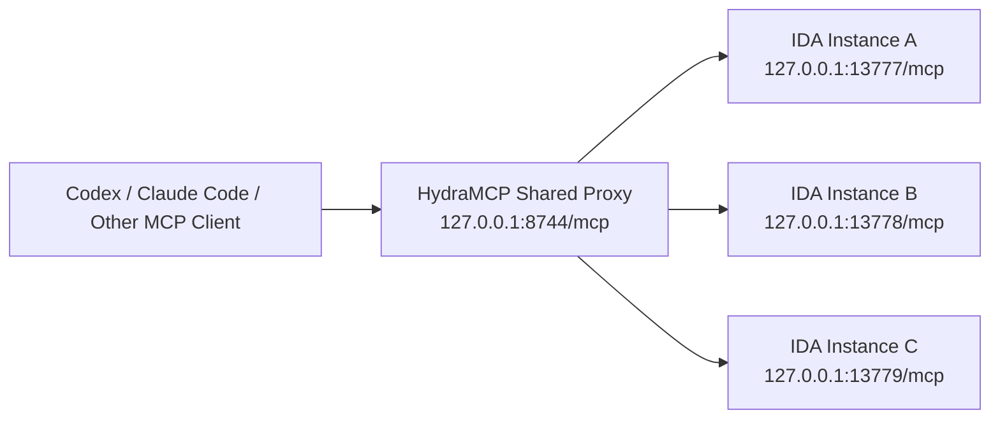

<p align="center">
  
</p>

<h1 align="center">HydraIDAMCP</h1>

<p align="center">
  A multi-session enhancement of <code>ida-pro-mcp</code> for parallel IDA workflows
</p>

<p align="center">
  <a href="./README.md">简体中文</a>
</p>

<p align="center">
  
  
  
  
</p>

HydraIDAMCP (short: **HydraMCP**) is an enhanced build of [`ida-pro-mcp`](https://github.com/mrexodia/ida-pro-mcp), designed for **CTF / RE / PWN / Malware** workflows where multiple IDA instances are open at the same time.

It does **not** replace `ida-pro-mcp` with a brand-new MCP stack. Instead, it extends the existing plugin and server architecture with:

- a **shared proxy** on `http://127.0.0.1:8744/mcp`
- **parallel local IDA instances**
- **per-session instance routing**
- instance selection by **binary** or **IDB path**
- **auto-generated prompts** with built-in binding steps
- **custom prompt templates**

> HydraMCP is built for one simple goal: when multiple IDA databases are open, the model should always analyze the correct one.

---

## Features

- Shared proxy endpoint on `8744`
- Auto-discovered local IDA MCP instances
- Independent local ports such as `13777`, `13778`, `13779`, ...
- Per-session binding via MCP transport session
- One-key startup from IDA: `Ctrl + Alt + M`
- Auto-generated prompts with binding steps included
- `select_instance_by_binary(...)`
- `select_instance_by_idb(...)`
- `current_instance()`
- `list_instances()`
- Custom prompt template support
- Compatible package / CLI naming with upstream `ida-pro-mcp`

---

## Why HydraIDAMCP

The upstream `ida-pro-mcp` is great for a single-instance workflow:

- one IDA
- one MCP server
- one analysis flow

But real CTF workflows are often different:

- multiple IDA windows open at once
- one IDB per challenge
- the model needs to know exactly which target it should analyze
- manually changing MCP configuration for every instance is tedious

HydraIDAMCP addresses exactly that:

> **multiple IDA instances, one MCP entrypoint, and reliable per-session target selection**

---

## Architecture

HydraMCP uses a two-layer design:

1. **Shared Proxy**
   - fixed endpoint: `127.0.0.1:8744`
   - MCP clients only need to connect here

2. **Local IDA Instance**
   - each IDA launches its own local MCP service
   - ports are allocated automatically starting from `13777`



The shared proxy maintains:

> **MCP transport session -> IDA instance**

So different sessions can stay attached to different targets instead of competing for one default IDA instance.

---

## Quick Start

### 1) Install the project

For source-based installation:

```bash
git clone https://github.com/Alsioy/HydraIDAMCP.git
cd HydraIDAMCP
pip uninstall ida-pro-mcp -y
pip install -e .
```

You can also install directly from GitHub:

```bash
pip uninstall ida-pro-mcp -y
pip install git+https://github.com/Alsioy/HydraIDAMCP.git
```

### 2) Install the IDA plugin

```bash
ida-pro-mcp --install
```

> The command name remains `ida-pro-mcp` on purpose for compatibility.

### 3) Configure your MCP client

Point your MCP client to the shared proxy:

```toml
[mcp_servers.ida_pro_mcp]
enabled = true
url = "http://127.0.0.1:8744/mcp"
```

### 4) Start from each IDA window

Press:

```text
Ctrl + Alt + M
```

HydraMCP will automatically:

1. check whether the shared proxy on `8744` is running
2. start it if necessary
3. allocate a local port for the current IDA instance
4. register the instance
5. generate a ready-to-send analysis prompt

### 5) Send the generated prompt to your model

The generated prompt already includes:

- current `IDB`
- current `Binary`
- binding steps
- `select_instance_by_idb(...)`
- `select_instance_by_binary(...)`
- `current_instance()`

So in most cases, your workflow becomes:

> **Open IDA -> Press `Ctrl + Alt + M` -> Send the generated prompt**

---

## Installation

### Requirements

- Python **3.11+**
- IDA Pro **8.3+** / **9.x**
- a working IDAPython environment
- **IDA Free is not supported**

### Option A: Install from source

```bash
git clone https://github.com/Alsioy/HydraIDAMCP.git
cd HydraIDAMCP
pip uninstall ida-pro-mcp -y
pip install -e .
ida-pro-mcp --install
```

### Option B: Install from GitHub

```bash
pip uninstall ida-pro-mcp -y
pip install git+https://github.com/Alsioy/HydraIDAMCP.git
ida-pro-mcp --install
```

### Notes

- restart IDA completely after installing the plugin
- some MCP clients also keep background processes alive, so a full restart may help
- if the upstream `ida-pro-mcp` was installed before, uninstalling it first is recommended

---

## Usage

HydraMCP is meant to stay simple in everyday use.

### 1. Open your targets

Open one IDA window per challenge.

### 2. Press the hotkey once in each IDA

```text
Ctrl + Alt + M
```

This single action will:

- start or reuse the shared proxy
- start the local MCP instance for the current IDA
- register the instance
- generate a ready-to-use prompt

### 3. Send the generated prompt to your model

This is one of HydraMCP's practical advantages:

- the prompt is generated automatically
- binding parameters are already included
- binding steps are already included
- you do not need to manually write `select_instance...` every time

So the model already knows:

- which challenge it should analyze
- which IDA MCP tools it should call first
- that it should not switch to another IDA instance

### 4. Use manual selection only when needed

If you want to switch manually, you can still call:

```text
list_instances()
current_instance()
select_instance("127.0.0.1", 13778)
select_instance_by_binary("checkin.exe")
select_instance_by_idb("D:/ctf/re/checkin/checkin.i64")
```

In short:

> **Open IDA -> Press `Ctrl + Alt + M` -> Send the generated prompt**

---

## Prompt Template

HydraMCP supports a local prompt template for generating prompts that stay bound to the current instance.

The design goals are simple:

- short enough to be useful immediately
- includes the current instance binding parameters automatically
- does not over-constrain the model
- easy to customize to your own workflow

### Default path

Windows:

```text
%APPDATA%\Hex-Rays\IDA Pro\mcp\prompt_template.txt
```

Or via environment variable:

```text
IDA_MCP_PROMPT_TEMPLATE
```

### Default template example

```text
You are a CTF binary analysis and solving assistant.

Please use IDA MCP to analyze the current challenge.

Only analyze this challenge. Do not switch to another IDA instance.

IDB: {idb_path}
Binary: {binary}

First bind and confirm the current instance:
{binding_steps}

Challenge type:
Challenge description:
Goal:
```

### Supported placeholders

- `{idb_path}`
- `{binary}`
- `{binding_steps}`
- `{local_instance_url}`
- `{shared_proxy_url}`
- `{select_instance_by_idb}`
- `{select_instance_by_binary}`
- `{current_instance_call}`
- `{list_instances_call}`

### Custom templates

You can edit the template file directly and adapt it to:

- RE workflows
- PWN workflows
- Malware workflows
- your own prompting style

HydraMCP does not impose a fixed prompt style. It simply injects the correct current-instance information and binding parameters.

---

## Common Tools

```text
list_instances()
current_instance()
select_instance("127.0.0.1", 13778)
select_instance_by_binary("checkin.exe")
select_instance_by_idb("D:/ctf/re/checkin/checkin.i64")
```

---

## Compatibility

To minimize migration cost, HydraIDAMCP keeps the upstream package and CLI names:

- Python package: `ida_pro_mcp`
- CLI command: `ida-pro-mcp`

So:

- **project / GitHub name**: `HydraIDAMCP`
- **short name**: `HydraMCP`
- **runtime package name**: still compatible with `ida-pro-mcp`

This makes HydraMCP closer to a **drop-in enhanced build** than a fully renamed fork.

---

## Project Layout

```text
src/ida_pro_mcp/server.py        # shared proxy, routing, instance selection
src/ida_pro_mcp/ida_mcp.py       # IDA plugin loader, shared proxy startup, prompt template
src/ida_pro_mcp/installer.py     # installer and MCP client config generation
src/ida_pro_mcp/ida_mcp/         # upstream ida-pro-mcp implementation and submodules
tests/                           # tests
```

---

## FAQ

### Is this a completely new MCP server?

No.  
HydraIDAMCP is a multi-session enhancement built on top of `ida-pro-mcp`, not a full rewrite of the protocol stack.

### Why is the command still `ida-pro-mcp`?

For compatibility with the existing package, CLI, and plugin workflow.  
The project is called HydraIDAMCP, but the runtime command stays `ida-pro-mcp`.

### Why did the shared proxy fail to start?

Common reasons:

- the selected Python environment does not have this project installed
- upstream `ida-pro-mcp` and HydraMCP are mixed together
- port `8744` is already in use

Recommended fix:

```bash
pip uninstall ida-pro-mcp -y
pip install -e .
```

---

## Roadmap

The current version is already usable for multi-challenge workflows, but there is still room for improvement:

- [ ] instance aliases / labels
- [ ] clearer instance status display
- [ ] prompt template profiles for RE / PWN / Malware
- [ ] automatic cleanup after abnormal exits
- [ ] more compatibility testing with MCP clients

---

## Acknowledgements

HydraIDAMCP is built on top of:

- [`mrexodia/ida-pro-mcp`](https://github.com/mrexodia/ida-pro-mcp)

The goal is not to replace the upstream project, but to extend it for **parallel CTF binary analysis workflows**.

---

## License

This project follows the upstream repository license. See [`LICENSE`](./LICENSE).
